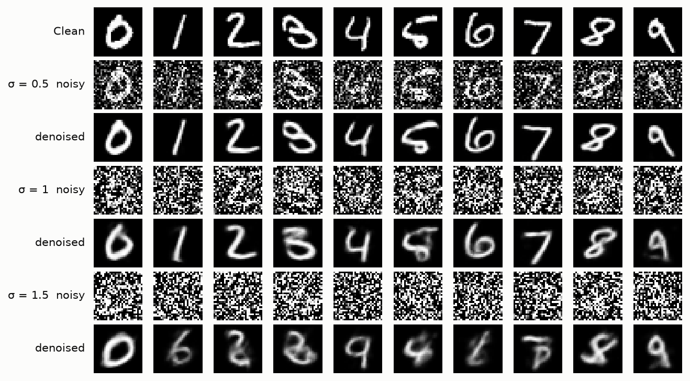
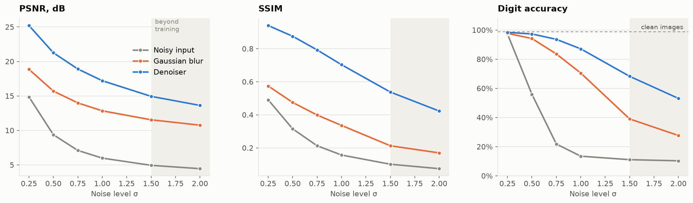
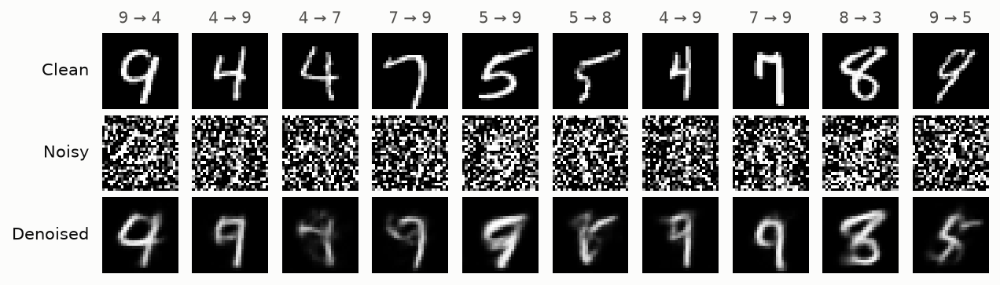
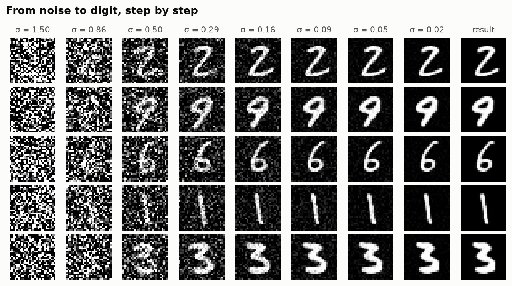
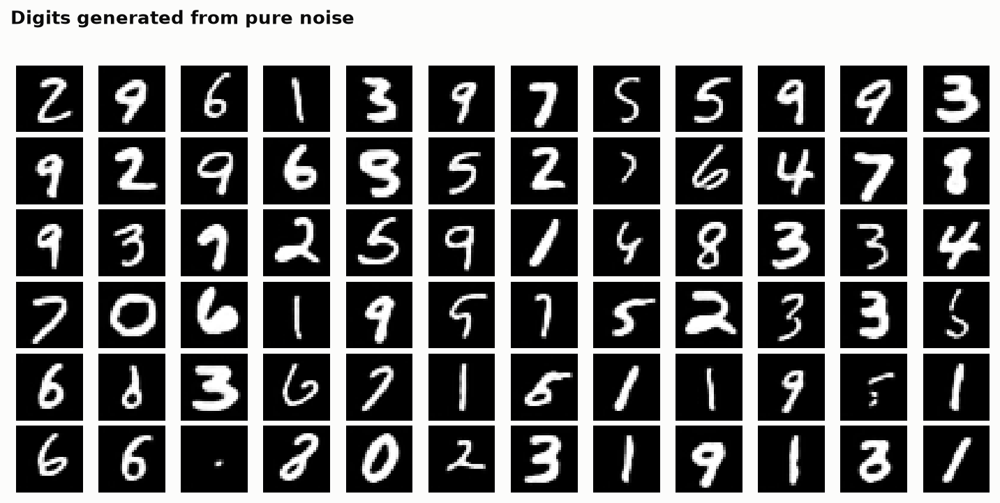
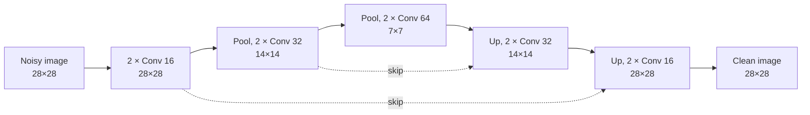

<h1 align="center">MNIST Denoising</h1>

<p align="center">
  <b>Pulling handwritten digits out of heavy noise with a small U-Net, then turning pure noise into new digits</b><br>
  CS416 Deep Learning · GIK Institute of Engineering Sciences &amp; Technology · 2022
</p>

<p align="center">
  
  
  
</p>

<p align="center">
  <a href="MNIST_Denoising.ipynb"><b>Notebook</b></a> ·
  <a href="docs/Project-Report.pdf">Project report</a> ·
  <a href="docs/Project-Presentation.pdf">Presentation</a> ·
  <a href="docs/Project-Proposal.pdf">Proposal</a>
</p>

---

> [!NOTE]
> This is a coursework project from my undergraduate studies (BS Computer Science, GIKI). I'm posting it to GitHub retroactively, for the record.
>
> The notebook is a clean rewrite of the project. The report and presentation describe the original coursework version.

## Overview

Diffusion models, the image generators behind tools such as DALL·E 2 and Midjourney, create images by removing noise a little at a time. This project, *"Evaluating the effectiveness of denoising diffusion models for synthesizing images"*, studies that denoising step at the smallest useful scale.

A small convolutional network learns to recover handwritten digits from heavy Gaussian noise. It is compared with a classic blur filter, checked with a separate digit classifier to see whether the digits stay recognisable, and finally used to create new digits from pure noise, the way a diffusion model does.

<p align="center">
  <br>
  <sub>One test digit of each class at three noise levels. At σ = 1 the noise is as large as the whole black-to-white range.</sub>
</p>

## Results

### Denoising

All scores are on the 10,000 MNIST test images, which the models never saw in training.

<p align="center">
  
</p>

| At σ = 1 | PSNR | SSIM | Digit accuracy |
| --- | ---: | ---: | ---: |
| Noisy input | 6.0 dB | 0.16 | 14% |
| Gaussian blur (best width for this noise level) | 12.8 dB | 0.34 | 71% |
| **Denoiser** | **17.2 dB** | **0.70** | **87%** |
| Clean images | | | 99% |

- **The denoiser beats a tuned blur filter at every noise level**, by about 3 to 6 dB of PSNR. Its SSIM, which tracks strokes and shapes, is 1.6 to 2.5 times the blur's.
- **Digits stay recognisable.** At σ = 1 a classifier reads only 14% of the noisy images correctly, barely better than guessing. After denoising it reads 87%.
- **It holds up beyond its training range.** The denoiser was trained on noise up to σ = 1.5. At σ = 2 it still recovers 53% of digits correctly, against 28% for the blur.
- **Outputs are softer than the originals,** more so as the noise grows. Under heavy noise several digits could fit, and the denoiser returns something between them.
- **Mistakes happen between similar shapes.** At σ = 1, 12% of test digits come back as a different digit. The most common swaps are 4 → 9, 7 → 9, 9 → 4, and 3 and 5 in both directions.

<p align="center">
  
</p>

### New digits from pure noise

The denoiser was only ever trained to clean up noisy images. Used over and over, it can also create digits. Start from pure noise, let the denoiser guess the clean image, add back slightly less noise, and repeat. Over 40 steps, a digit emerges.

<p align="center">
  
</p>

<p align="center">
  
</p>

- **Most results are convincing digits.** A classifier is at least 90% sure which digit it is looking at for 90% of 1,000 generated images. For real test digits that figure is 96%.
- **The digits don't come out evenly.** Nothing controls which digit appears: 1s and 9s are the most common, and 0s and 2s the rarest. Diffusion models used in practice add a text or class input to steer the result.

## How it works

**Noise.** Every pixel gets random Gaussian noise with standard deviation σ. Pixels run from 0 (black) to 1 (white). During training, every batch gets fresh noise at a random level between 0 and 1.5, so the network never sees the same noisy image twice and has to judge the noise level by itself.

**Model.** A small U-Net, the same kind of network diffusion models use:



The encoder shrinks the image while adding channels, so it can recognise strokes and shapes. The decoder builds the image back up, and skip connections carry fine detail straight across. The output layer is linear, and its values are clipped to the 0–1 pixel range.

| Setting | Value |
| --- | --- |
| Data | MNIST: 55,000 training, 5,000 validation and 10,000 test images |
| Model | U-Net, 116,753 parameters |
| Loss | Mean squared error against the clean image |
| Optimizer | AdamW, learning rate 1e-3 (halved when validation loss stalls), weight decay 1e-4 |
| Training | 20 epochs, batch size 128; about 14 minutes on a 2-core CPU |
| Generation | 40 steps, noise falling from σ = 1.5 to 0.02, starting from the average training image plus noise |

**Evaluation.** Three outputs are compared at six noise levels from σ = 0.25 to 2: the noisy input, a Gaussian blur (its width tuned on the validation set for each noise level) and the denoiser. Each is scored by:

- **PSNR**: how close the pixels are to the clean image, in decibels. Higher is better.
- **SSIM**: how well local shapes and strokes match, from 0 to 1.
- **Digit accuracy**: the share of outputs that a separate classifier reads as the right digit. The classifier is a small CNN trained only on clean images, with 98.7% test accuracy.

## Running it

```bash
pip install -r requirements.txt
jupyter notebook MNIST_Denoising.ipynb
```

MNIST downloads automatically. The trained denoiser and classifier are included in [`models/`](models), and the notebook loads them, so a full run takes a few minutes. Set `RETRAIN = True` to train both from scratch, which takes about 15 minutes on a CPU. Section 7 of the notebook lets you pick any digit and noise level and see the result.

## Team

**Asad Shahab** · Shams Ghani

Instructor: Dr. Khurram Jadoon

## References

1. J. Ho, A. Jain, P. Abbeel. *Denoising Diffusion Probabilistic Models.* NeurIPS 2020. [arXiv:2006.11239](https://arxiv.org/abs/2006.11239)
2. Y. LeCun, C. Cortes, C. J. C. Burges. *The MNIST database of handwritten digits.*
3. O. Ronneberger, P. Fischer, T. Brox. *U-Net: Convolutional Networks for Biomedical Image Segmentation.* MICCAI 2015. [arXiv:1505.04597](https://arxiv.org/abs/1505.04597)
4. Z. Wang, A. C. Bovik, H. R. Sheikh, E. P. Simoncelli. *Image Quality Assessment: From Error Visibility to Structural Similarity.* IEEE Transactions on Image Processing, 2004.
5. Z. Kadkhodaie, E. P. Simoncelli. *Stochastic Solutions for Linear Inverse Problems using the Prior Implicit in a Denoiser.* NeurIPS 2021. [arXiv:2007.13640](https://arxiv.org/abs/2007.13640)
